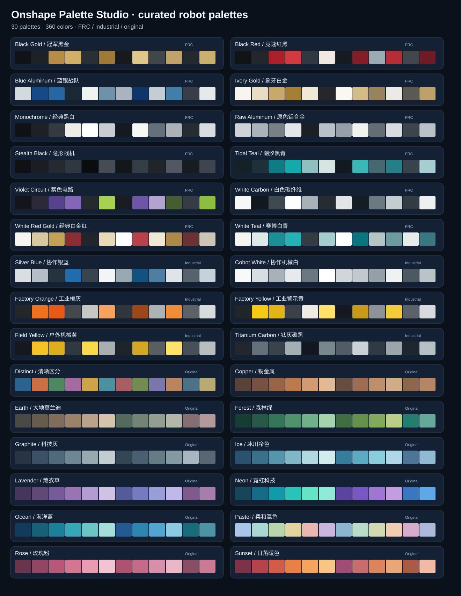

# Onshape Palette Studio v0.2

一个无需 API Key、无需浏览器注入的 **Onshape 原生 FeatureScript 配色工具**。

**本版本能力：**30 套色系（原有 12 + FRC 12 + 工业机器人 6）× 每套 12 个颜色 × 4 种分配模式 × 8 个可复现的变化配置；可以一次给当前 Part Studio 中的所有实心零件，或所选零件批量上色。改变该 Feature 的参数，就能重新给零件分配协调色。仅改变外观，不修改模型几何、材料、质量属性或配合关系。

## v0.2 新增：FRC & Industrial 配色库

首选尝试：**Monochrome 黑白、Ivory Gold 白金、Black Gold 黑金、Stealth Black 枪黑、White Teal 白青、Titanium Carbon 钛灰**。这些配色更符合机械装配的审美：主体、结构件与点缀色有层次，而不是仅使用单色渐变。

### FRC / 竞赛机器人（新增 12 套）

| ID | 配色风格 | 灵感 |
|---|---|---|
| `MONOCHROME` | 极简黑白 + 中性灰 | 1538 / 3847 等简洁机器人 |
| `IVORY_GOLD` | 象牙白 + 香槟金 | 118 的白金风格 |
| `BLACK_GOLD` | 哑光黑 + 复古金 | 黑金与阳极氧化视觉 |
| `STEALTH_BLACK` | 纯黑 + 低对比枪灰 | 148 的 all-black 风格 |
| `BLACK_RED` | 黑色结构 + 暗红点缀 | 148 / 4488 风格 |
| `WHITE_TEAL` | 冷白 + 青绿 + 银灰 | 4414 HighTide |
| `TIDAL_TEAL` | 黑青 + 金属灰 | 黑青机械结构 |
| `WHITE_RED_GOLD` | 白金 + 深红细节 | 118 的经典组合 |
| `VIOLET_CIRCUIT` | 深紫 + 黑 + 荧光绿 | 195 / 1885 的色彩讨论 |
| `BLUE_ALUMINUM` | 皇家蓝 + 自然银 | 254 与阳极氧化蓝 |
| `RAW_ALUMINUM` | 磨砂银 + 原色铝 | 裸铝、喷砂加工 |
| `WHITE_CARBON` | 冷白 + 烟灰 + 碳黑 | 白色护板与深色聚碳酸酯 |

来源：[Chief Delphi — Best Robot Color Scheme?](https://www.chiefdelphi.com/t/best-robot-color-scheme/353010)、[讨论后续](https://www.chiefdelphi.com/t/best-robot-color-scheme/353010?page=4)、[6995 NOMAD：黑色阳极氧化与裸铝的对比](https://www.chiefdelphi.com/t/frc-nomad-6995-2025-build-thread/477260?page=2)。这些案例支持风格存在，不构成 FRC 队伍使用比例统计。

### Industrial / 工业及协作机器人（新增 6 套）

| ID | 配色风格 | 启发来源 |
|---|---|---|
| `ORANGE_GRAPHITE` | 安全橙 + 深灰 | KUKA 工业橙 |
| `SAFETY_YELLOW` | 警示黄 + 黑色关节 | FANUC |
| `COBOT_WHITE` | 白色机壳 + 多级灰 | ABB GoFa |
| `COBOT_SILVER_BLUE` | 银灰 + 蓝色点缀 | 现代协作机器人 |
| `SPOT_YELLOW` | 野外警示黄 + 黑 | Spot 类户外机器人 |
| `TITANIUM_CARBON` | 钛灰 + 碳黑 | 工业机械手、机床结构 |

参考：[ABB GoFa 白灰色说明](https://new.abb.com/news/detail/74805/abb-launches-gofa-higher-payload-cobot-for-collaborative-tasks-up-to-5kg)、[KUKA Industrial Orange 产品资料](https://my.kuka.com/s/product/iw-300-assy/01t1i000000ARtmAAG?language=en_US)、[工业机器人品牌颜色历史](https://robohub.org/old-and-new-at-automate-2013/)、[Boston Dynamics Spot](https://bostondynamics.com/products/spot/)。

**重要边界：**所有新增颜色都是本项目的独立视觉设计，并非团队或厂商的官方 HEX 值或授权配色。所谓金属金、钛灰、碳纤维黑仅是 RGB 外观色，不能代表材质纹理、金属反射或实际表面处理。原有 12 套的 HEX 顺序保持不变。

### 维护与检查

编辑 `palettes.json`，执行 `python build.py`，随后运行 `python -m unittest discover -s tests -v`。代码生成器会同步 FeatureScript、预览和色卡总览。在 Onshape 中试用时请先使用测试文档；这不是直接修改所有 Assembly instances 的 OAuth 插件。

## 安装：在 Onshape 中（不是在本地运行 `.fs` 文件）

1. 建议先在**副本/测试文档**中试用。打开包含至少 3 个独立实心零件的 Onshape 文档。
2. 点击左下角 `+` 添加 **Create Feature Studio**，新建一个 Feature Studio。
3. 将 `src/palette_studio.fs` 的**完整内容**粘贴进 Feature Studio，替换初始模板，保存/提交（Onshape 编辑器会做语法和预处理检查）。
4. 在 Part Studio 中，使用 Onshape **Add custom features** 将该 Feature Studio 的 `Palette Studio` 加到工具栏（同文档时可从自定义特征来源中查找）。
5. 建议把 Part Studio 的回滚条拖到最后、把该 Feature 放在建模特征列表末尾。点击 **Palette Studio**，选择 Palette / Color scope / Arrangement / Variation，确认。
6. 若装配体引用这些零件，返回 Assembly 查看外观变化。可以编辑同一个 Feature 来更换色系或排列，无需逐一选色。

**选择范围：** `All solid parts` 默认将当前 Part Studio 里所有实心零件上色。选 `Selected parts only` 可以只改变选中的零件。

**撤销/复原：**撤销插入该 Feature，或在特征树中删除/抑制它，返回先前的外观历史。如果原先对部分面单独指定了外观，面级外观可能覆盖零件级配色。

## 颜色预览

双击 `preview/palette-preview.html`，无需网络或账号即可预览 30 色系、查看 12 个零件的示意组合、切换排列、复制 HEX、导出 CSV。预览页**不连接 Onshape**，页面的色系/排列/变化选项和 FeatureScript 相同。

## 特别说明：装配体的支持边界

- 此版本通过修改**来源 Part Studio** 的零件 Appearance，让同样的颜色显示在引用该零件的 Assemblies 中。
- 如果你的 Assembly 引用了多个不同 Part Studio/外部文档，需要到各来源 Part Studio 使用一次本工具；不能从一个装配体直接修改所有零件的源文件。
- 同一源零件在同一配置下被装入多个位置时，其外观通常相同；不能靠此 Feature 给每个 instance 单独换色。
- 只读/版本引用、导入的供应商零件、外观配置和面级覆盖，可能影响最终能否改变或显示预期颜色。
- 此包尚**未通过你的 Onshape 账户实际编译/装配模型验证**，提供源码、纯离线检查和可复现的安装说明。若 Onshape Feature Studio 的编译器提示具体报错，可据报错修正。
- 若需要**真正的装配体页面一键改色、包括不同来源的零件**，需要另做一个 Onshape OAuth App（托管后端 + 权限授权 + 按来源文档/配置遍历并更新），不能由纯 FeatureScript 在 Assembly 中直接完成。

## 项目文件

- `src/palette_studio.fs` — 在 Onshape 内安装和运行的真实 FeatureScript 代码。
- `palettes.json` — 30 套色系、360 个 HEX 色值；它是唯一的配色数据源。
- `preview/palette-preview.html` — 离线可视化预览（支持按 FRC / Industrial / Original 分类）。
- `preview/palette-gallery.svg` — GitHub 上直接可视化查看的全色卡。
- `tests/test_palettes.py` — 不依赖 Onshape 的静态检查；运行 `python -m unittest discover -s tests -v`。
- `build.py` — 从 `palettes.json` 重生成 FeatureScript、离线预览 HTML 和 SVG 总览。

## 技术参考

- 官方 FeatureScript 文档：https://cad.onshape.com/FsDoc/index.html
- 官方 Custom Feature：https://www.onshape.com/en/features/custom-features
- 官方 Appearance：https://cad.onshape.com/help/Content/PartStudio/customizing_appearances.htm

License: MIT. This project is a community prototype, not an official PTC/Onshape product.